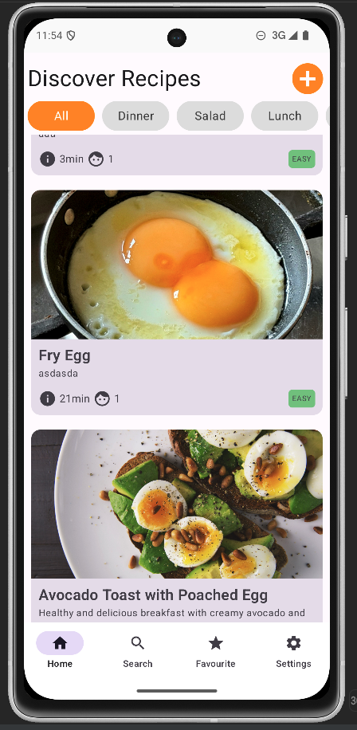
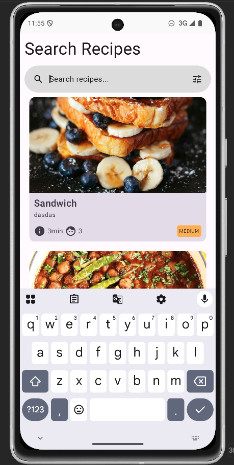
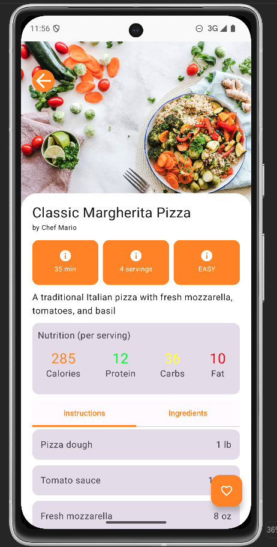
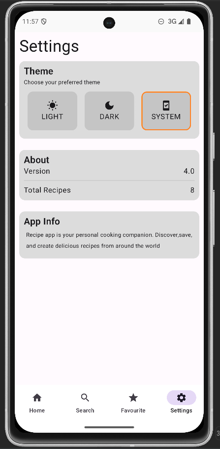
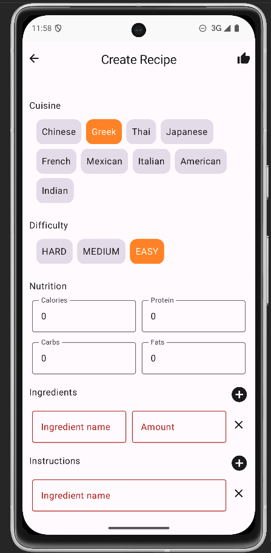
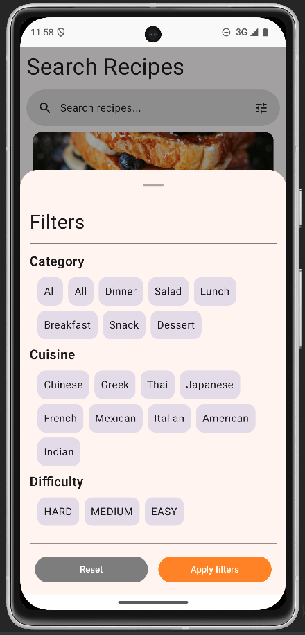
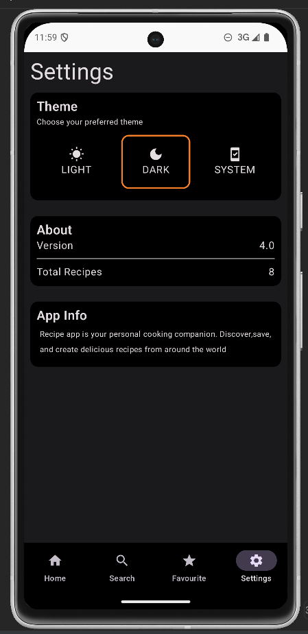
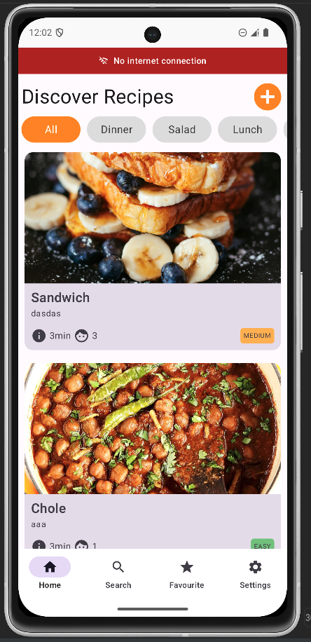

# 🍳 RecipeApp

A modern, **offline-first** recipe discovery and creation app for Android, built with Kotlin and Jetpack Compose. RecipeApp lets users browse, search, favorite, and create recipes — all while remaining fully functional without an internet connection.

> Built as a deep-dive into production-grade offline-first architecture: local-first writes, background sync, conflict-safe caching, and clean separation of concerns across every layer.

---

## ✨ Features

- 📖 **Browse & filter recipes** by category, cuisine, and difficulty
- 🔍 **Search** recipes by title
- ❤️ **Favorites** — works fully offline, syncs automatically when reconnected
- ➕ **Create recipes** — including image upload — even with no internet
- 🖼️ **Image handling** — local caching with automatic background upload to the cloud
- 🌐 **Offline-first** — every screen reads from a local database first; the network only refreshes it
- 🔄 **Automatic background sync** — pending changes are pushed the moment connectivity returns
- 🎨 **Dynamic theming**
- 📡 **Live connectivity banner** — informs the user when they're offline, app-wide

---

## 📸 Screenshots

  
  
  
  

  
  
  
  

---

## 🏗️ Architecture

RecipeApp follows **MVVM** with a clean, layered **Repository pattern** and an **offline-first / local-as-single-source-of-truth** design — the same architecture used by apps like Gmail, Notion, and Google Docs.

The UI observes state exposed by the ViewModel, which delegates all data operations to a Repository. The Repository is the only layer aware that both a local database and a remote backend exist — it decides when to read from Room, when to refresh from Firestore, and how to keep the two in sync, so nothing above it ever needs to know the difference.

The remote data source sits behind its own interface, so the backend itself is swappable without touching any other layer. The app currently ships with a Firestore implementation, but a GraphQL implementation is also built and ready to be switched in with a single dependency-injection change.

### Core principles

- **Single source of truth** — the UI *always* reads from Room. The network's only job is to refresh the local cache in the background.
- **Local-first writes** — every user action (favoriting, creating a recipe) is saved locally *immediately*, working fully offline, and synced to the backend opportunistically.
- **Never lose data** — pending, unsynced changes are protected from being overwritten or deleted by background refreshes.
- **Idempotent sync** — remote sync operations always apply the *known* local state (e.g. explicit `set`/`delete`) rather than blind toggles, so retries are always safe.

---

## 🧰 Tech Stack

| Layer | Technology |
|---|---|
| Language | Kotlin |
| UI | Jetpack Compose |
| Architecture | MVVM + Repository pattern |
| Dependency Injection | Hilt |
| Local Database | Room |
| Async | Kotlin Coroutines + Flow |
| Remote Backend | Firebase Firestore (GraphQL data source also implemented, swappable) |
| Image Hosting | Cloudinary |
| Navigation | Navigation Compose |
| Logging | Timber |
| Connectivity | `ConnectivityManager` wrapped as a reactive `Flow` |

---

## 📴 Offline-First Design

This is the heart of the project. A few of the patterns implemented:

- **Reads are always local.** Every screen observes Room via `Flow` — the UI never waits on the network to render.
- **Writes are local-first.** Creating a recipe or toggling a favorite updates Room instantly; the Firestore/Cloudinary sync happens transparently afterward.
- **Sync-state tracking.** Local entities carry `isSynced` / `isImageUploaded` flags, so nothing is ever pushed to the server twice or lost if a sync attempt fails mid-flight.
- **Safe stale-data cleanup.** When refreshing from the server, previously-synced records that were deleted remotely are removed locally too — while anything still pending sync is explicitly protected from deletion.
- **Reactive connectivity.** A `callbackFlow`-based `NetworkMonitor` observes connectivity changes in real time and automatically triggers a sync pass the moment the device reconnects.
- **Local image caching.** Images are copied to internal storage immediately on pick, displayed instantly, and swapped for their permanent Cloudinary URL once uploaded — with automatic retry if the upload didn't complete.

---

## 🔧 CI/CD

This project uses **GitLab CI/CD** to automatically build a debug APK on every push, catching build breakages early and giving reviewers an installable artifact without needing to build locally.

The pipeline builds a debug APK via Gradle on every push, then publishes it as a downloadable pipeline artifact. This means every merge request produces a fresh, installable build — broken builds are caught before they reach `main`, and a ready-to-test APK is always just one click away in the pipeline results, with no local setup required.

---

## 📌 What This Project Demonstrates

- Designing and reasoning about a real offline-first sync architecture from first principles
- Correctly sequencing local-write → remote-sync → confirm-then-flag operations to avoid data loss and race conditions
- Structuring Hilt dependency graphs across Room, Firestore, and connectivity monitoring
- Writing idempotent, retry-safe sync logic
- Clean separation of concerns: ViewModel never touches Room or Firestore directly — only ever through the Repository

---

## 📄 License

This project is available for review as part of a personal portfolio. Please reach out before reuse.

---

*Built by [Abid Suhail](https://gitlab.com/abid1294005/recipeapp-phase1) — feedback and questions welcome.*